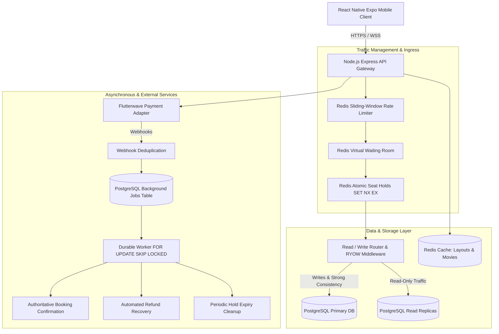
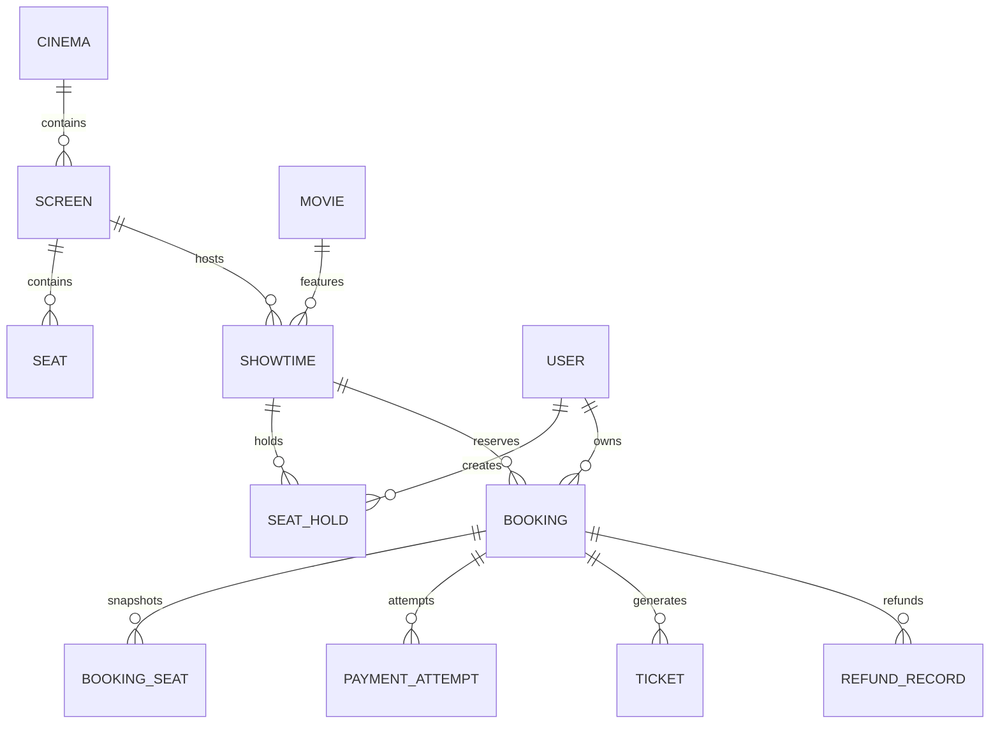
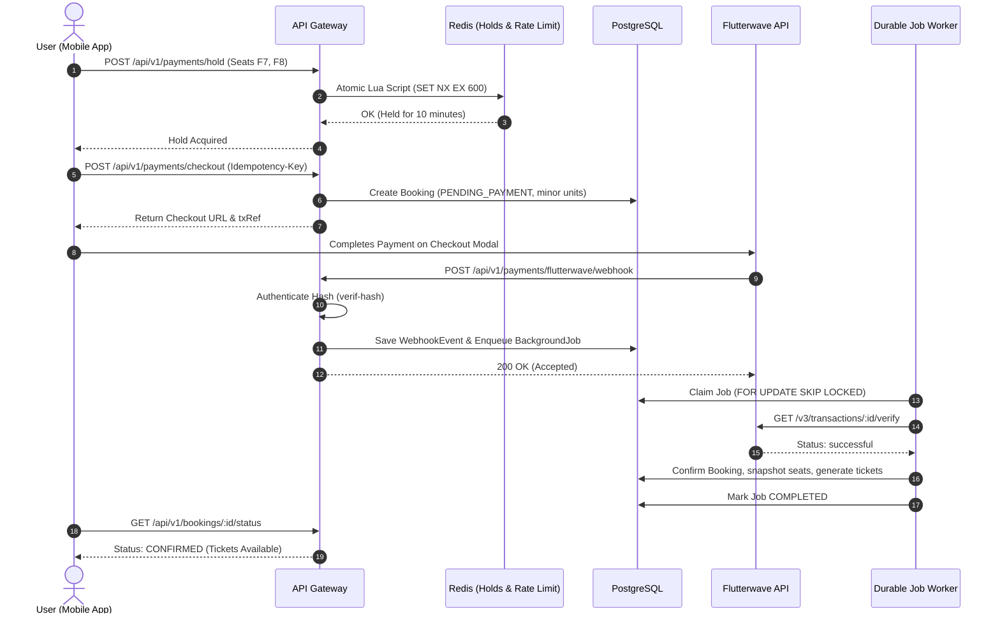

# Matinee System Architecture (ARCHITECTURE.md)

This document provides a comprehensive technical breakdown of the Matinee cinema reservation and ticketing platform architecture, covering system topology, data integrity invariants, payment workflows, traffic management, and background processing.

---

## 1. High-Level Architecture Topology

---

## 2. Core Architectural Pillars

### Pillar 1: Separation of Presentation, Domain, & External Providers
- **Mobile Presentation**: React Native client handles view rendering and user interactions based strictly on design tokens. The client is **never authoritative** for pricing, seat availability, or payment success.
- **Backend Domain Logic**: Express routes validate input, enforce authentication, and delegate business workflows to domain services (`bookingService.js`, `waitingRoomService.js`).
- **External Provider Boundaries**: Payment integrations (Flutterwave) and catalog integrations (TMDB) sit behind isolated adapters with deterministic fallback and test sandboxing.

### Pillar 2: Financial & Minor-Unit Precision
- **No Floating-Point Arithmetic**: All prices, fees, and totals are stored and manipulated as integers in the smallest currency minor unit (e.g. `450000` kobo for `₦4,500.00`).
- **Server-Calculated Fees**: Service fees (e.g. ₦300/ticket) are calculated strictly on the backend during checkout creation.
- **Ledger Records**: All cancellations and refunds write an immutable audit trail in `refund_records`.

### Pillar 3: Zero Double-Allocation Concurrency Model
1. **L1 In-Memory Lock**: Single-seat holds use `SET seat_hold:{showtimeId}:{seatId} {userId} NX EX 600`. Multi-seat holds execute an all-or-nothing Lua script.
2. **L2 Database Invariant**: PostgreSQL enforces a unique partial constraint on `booking_seats (showtime_id, seat_id)`. Even under catastrophic Redis loss, PostgreSQL rejects concurrent duplicate bookings atomically.

### Pillar 4: Read-Your-Own-Writes (RYOW) Database Routing
- Primary/Replica splitting offloads catalog reads while routing mutations to the master.
- To eliminate replication lag artifacts for users who just performed a booking action, the server tracks write timestamps in Redis (`ryow:user:<userId>`) with a 5-second TTL.
- Reads within this window automatically route to the **Primary** database.

---

## 3. Database Schema & Entity Relationships

The relational model is managed via Prisma ORM on PostgreSQL with strict referential integrity (`Restrict` on critical financial parents):

- **`showtimes`**: Defines pricing, screen, movie, and schedule.
- **`seat_holds`**: Temporary 10-minute locks created during checkout.
- **`bookings`**: Master order record with unique `idempotency_key` and status (`PENDING_PAYMENT`, `CONFIRMED`, `CANCELLED`, `REFUNDED`).
- **`booking_seats`**: Purchase-time snapshot of seat labels and prices with unique constraint on `(showtime_id, seat_id)`.
- **`background_jobs`**: PostgreSQL transactional queue supporting `SKIP LOCKED` processing.

---

## 4. Payment & Checkout Lifecycle

---

## 5. Traffic Management & Scalability

1. **Virtual Waiting Room**: Gates concurrent active checkout users per showtime to 50 active users, admitting queued users at 10 users every 2 seconds.
2. **Sliding-Window Rate Limiting**: Redis sorted-set window limiting hold requests to 10/min, checkout to 5/min, and search to 60/min.
3. **Caching**: Movie details and screen seat layouts cached in Redis. Real-time availability delivered via Server-Sent Events (SSE) with polling fallback.
4. **Graceful Degradation**: 503 and 429 errors include `Retry-After` headers; mobile UI displays interactive retry options.

---

## 6. Observability & Telemetry

- **Request IDs**: Middleware generates and binds `X-Request-Id` UUID to every request, passing it into structured access logs and response headers.
- **Client & Server Telemetry**: Client crashes and server 5xx errors are logged with stack traces and reported to `POST /api/v1/telemetry/errors`.
