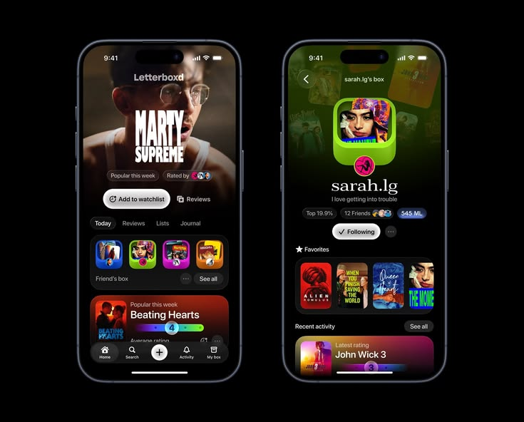
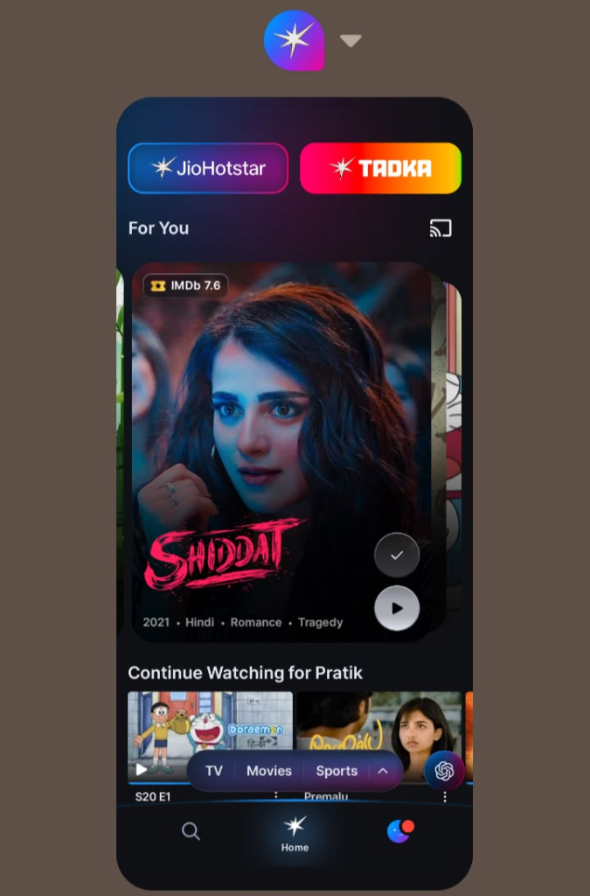
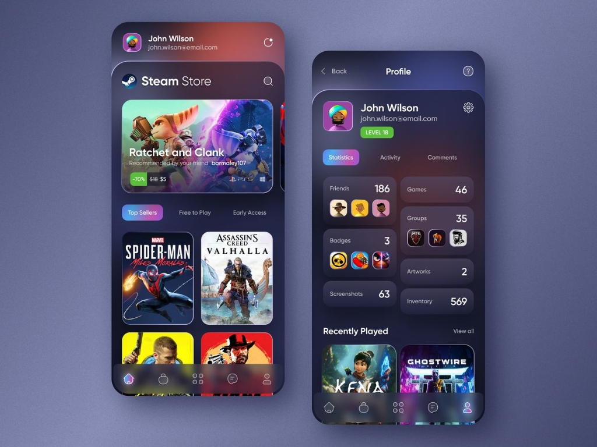
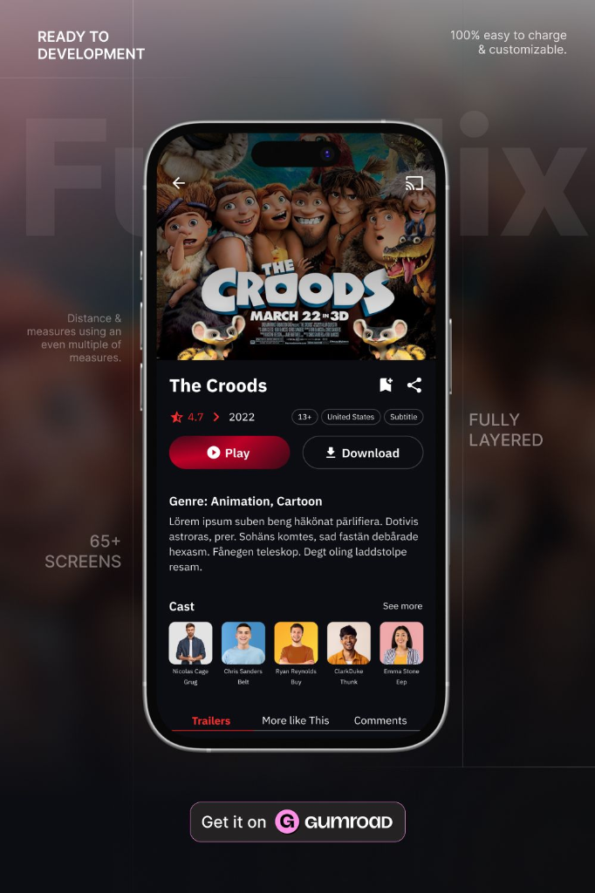
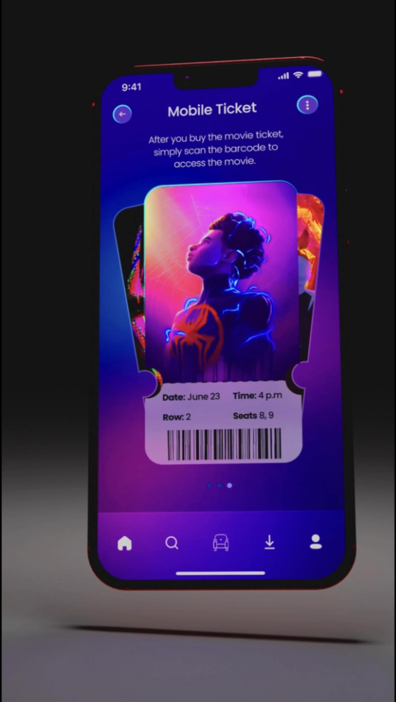

# Design Inspirations & Comparative App Study

This document fulfills the design research requirement:
> **"Study 5 well-made apps you admire. Screenshot what you like and write one line on why each works. Include this in your docs."**

Below are the 5 curated mobile design references, accompanied by the captured screenshots, core user observations, concise "why it works" rationales, and their direct applicability to **Matinee**.

---

## 1. Letterboxd – Immersive Film Discovery & Social Profiles

- **Key Highlights:** Edge-to-edge movie poster fading into deep black background, vibrant rounded squircle badges ("Friend's box"), pill-shaped action buttons (`+ Add to watchlist`, `Reviews`), horizontal "Favorites" poster shelf, and a floating dock navigation bar.
- **Why it works:** Dark edge-to-edge imagery with soft gradient scrims creates an immediate cinematic mood while keeping typography and action pills ultra-legible.
- **Application to Matinee:** Hero featured movies on the Discover tab can use this edge-to-edge backdrop fade, while user profiles can feature a "Favorite Cinemas" or "Saved Movies" horizontal shelf.

---

## 2. JioHotstar / Modern Streaming – Card-in-Card Carousel & Ambient Dock

- **Key Highlights:** Centered movie card carousel with rounded corners, top IMDb score badge, floating in-card circular action buttons (watchlist checkmark & play/book), floating category capsule filter (`TV`, `Movies`, `Sports`), and ambient glow beneath the active nav icon.
- **Why it works:** Floating card depth and in-card micro-actions provide clear content hierarchy and allow fast interaction without navigating away from the feed.
- **Application to Matinee:** Can be used for "Now Showing" hero carousels with an overlay badge for TMDB rating and a direct "Book" quick-action button on the card.

---

## 3. Steam Store – Two-Column Poster Grid & Category Pills

- **Key Highlights:** High-contrast category pill tabs (`Top Sellers`, `Free to Play`, `Early Access`), a structured 2-column vertical poster card grid, and a frosted glassmorphic bottom navigation bar.
- **Why it works:** The balanced 2-column card grid maximizes screen real estate and image impact while category pills enable fast, thumb-friendly content filtering.
- **Application to Matinee:** Perfect for Matinee's movie browsing grid—categorizing showtimes by "Now Showing", "Coming Soon", "Trending", or genre filters with zero visual clutter.

---

## 4. Funflix – Full-Screen Movie Details & Cast Architecture

- **Key Highlights:** Full-screen movie detail page (rather than a cramped pop-up modal), edge-to-edge backdrop art, circular cast portraits with actor & character names, prominent primary action button, and sticky bottom content tabs (`Trailers`, `More Like This`, `Comments`).
- **Why it works:** Full-screen presentation gives movies theatrical breathing room, organizing cast, synopsis, and trailers into a clear vertical reading rhythm with an anchored primary booking CTA.
- **Application to Matinee:** Replacing the current small movie modal in `DashboardScreen.js` with a dedicated full-screen movie detail experience featuring TMDB cast members, genre pills, synopsis, and a prominent "Select Showtimes & Seats" button.

---

## 5. Mobile Cinema Ticket – Skeuomorphic Notch Pass & Instant Glanceability

- **Key Highlights:** Cinema pass card with classic circular cut-out notch stubs, top poster artwork, bottom perforated details stub displaying Date, Time, Row, Seats, and scannable barcode/QR code, with a stacked 3D carousel effect for multi-ticket bookings.
- **Why it works:** The authentic physical ticket silhouette instantly signals the pass's real-world purpose, grouping critical entry data (hall, row, seat, barcode) in a single scannable glance for cinema gate entry.
- **Application to Matinee:** Enhancing Matinee's "My Tickets" tab with notch cut-out ticket cards and scannable booking verification codes for gate scanners.

---

## Synthesis: UI Elements for Matinee Roadmap

| App Inspiration | Core Feature | Matinee Implementation Target |
| :--- | :--- | :--- |
| **Letterboxd** | Hero Backdrop Fade & Action Pills | Discover Screen Hero Header & Category Pills |
| **JioHotstar** | In-Card Rating Badges & Ambient Active Glow | Movie Poster Badges & Bottom Navigation Styling |
| **Steam Store** | 2-Column Responsive Card Grid | Discovery Movie Feed Grid Layout |
| **Funflix** | Dedicated Full-Screen Details & Cast Rails | Full-Screen Movie Info Page (replacing modal) |
| **Mobile Ticket** | Perforated Notch Ticket Pass & Barcode | "My Tickets" Tab & Cinema Gate Scanner |
